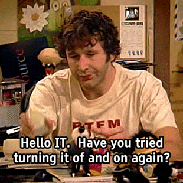

<!-- ========== HERO SECTION ========== -->

# PURURAJ CHOUDHARY

### ☁️ Cloud & DevOps Engineer

 

<!-- Animated Character -->

 

  
  

---

<!-- ========== ABOUT ME ========== -->

## 👨‍💻 About Me

I'm a Cloud & DevOps Engineer passionate about automating infrastructure,
building scalable Kubernetes environments, and implementing GitOps workflows.

* ☁️ Working with Microsoft Azure and Kubernetes
* 🚀 Implementing GitOps using ArgoCD and Helm
* 🔄 Building CI/CD pipelines with GitHub Actions
* 📊 Exploring Cloud Observability with Dynatrace and Datadog
* 🐧 Linux Administration | RHCSA | RHCE

---

<!-- ========== TECH STACK ========== -->

## ⚙️ Tech Stack

### Cloud & Infrastructure

### DevOps & Containers

### Monitoring & Scripting

---

<!-- ========== PROJECTS ========== -->

## 🚀 Featured Projects

<table>
<tr>
<td width="50%">

### 🔵 Multi-Environment GitOps

ArgoCD ApplicationSet + Helm

* Automated deployment management
* Dev, QA and UAT environments
* GitOps-based application delivery

</td>

<td width="50%">

### ☁️ AKS Observability

Azure Kubernetes Service

* Kubernetes monitoring
* OpenTelemetry integration
* Cloud infrastructure observability

</td>
</tr>

<tr>
<td width="50%">

### ⚡ Kubernetes Autoscaling

KEDA + Kubernetes

* Event-driven scaling
* ScaledObject implementation
* Workload optimization

</td>

<td width="50%">

### 🔄 CI/CD Automation

GitHub Actions + Azure

* Automated build pipelines
* Container image management
* Kubernetes deployments

</td>
</tr>
</table>

---

<!-- ========== GITHUB STATS ========== -->

## 📊 GitHub Statistics

---

  

<!-- ========== FOOTER ========== -->

### 💡 Automate Everything. Monitor Everything. Improve Everything.

