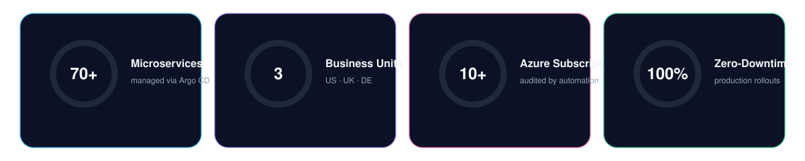
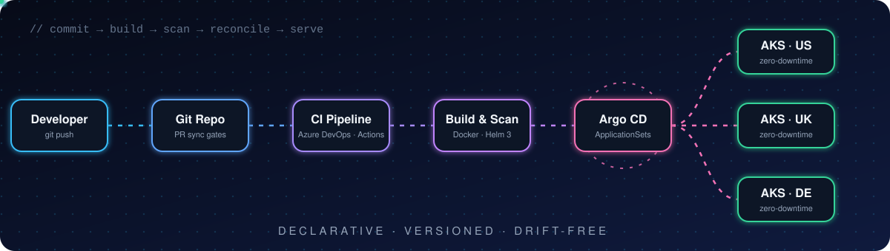
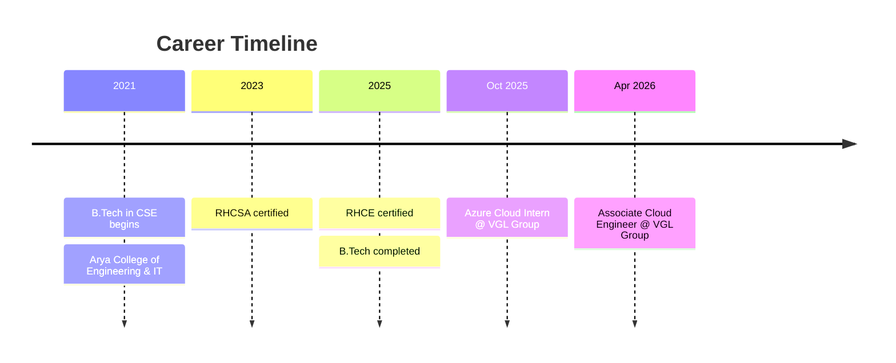

<!-- ═══════════════ HERO ═══════════════ -->

<div align="center">



<a href="https://github.com/Pururaj023">
  
</a>

<br/><br/>

<a href="https://prc-portfolio.netlify.app/"></a>
<a href="https://www.linkedin.com/in/pururaj2301"></a>
<a href="mailto:pururajchoudhary2301@gmail.com"></a>


</div>

<br/>

<!-- ═══════════════ TERMINAL ═══════════════ -->

<div align="center">
  
</div>

<br/>

<!-- ═══════════════ PRODUCTION SCALE ═══════════════ -->

<div align="center">

## ⚡ Production Scale



</div>

---

<!-- ═══════════════ ABOUT ═══════════════ -->

## 🧠 About Me

```yaml
name:      Pururaj Choudhary
role:      Associate Cloud Engineer @ VGL Group (Jaipur, India)
focus:     [Azure, AKS, GitOps, SRE, Observability]
certified: [RHCE (2025), RHCSA (2023)]
education: B.Tech CSE, Arya College of Engineering & IT (2021-2025)
mission:   "Make infrastructure boring, deployments invisible, and incidents rare."
currently: Scaling GitOps delivery and observability across 3 international business units
```

I run production Kubernetes for a global e-commerce group: multi-cluster **Argo CD** delivery for **70+ microservices**, **KEDA/HPA** autoscaling that absorbs promotional traffic spikes, and an observability stack (**Dynatrace, ELK, Grafana, OpenTelemetry**) that cuts time-to-isolate when things go sideways. I automate the boring stuff with **Terraform**, **Bash + Azure CLI**, and pipelines that scan before they ship.

---

<!-- ═══════════════ TECH ═══════════════ -->

<div align="center">

## 🛠️ Arsenal



<br/>


</div>

---

<!-- ═══════════════ GITOPS FLOW ═══════════════ -->

<div align="center">

## 🔁 How I Ship



</div>

---

<!-- ═══════════════ FEATURED WORK ═══════════════ -->

## 🚀 Featured Work

<table>
<tr>
<td width="50%" valign="top">

### 🔵 GitOps Multi-Cluster Onboarding
`Argo CD` · `ApplicationSets` · `Helm 3`

- Standardized ApplicationSets across clusters
- Fully automated microservice onboarding
- Rollout drift reduced to **zero**
- PR-based sync gates → **100% zero-downtime** prod rollouts

</td>
<td width="50%" valign="top">

### 🛡️ Azure Monitor Audit Automation
`Bash` · `Azure CLI` · `jq`

- End-to-end audit suite over Azure Resource Manager APIs
- Enforces **AMA, DCR, Container Insights** & alert coverage
- Runs across **10+ subscriptions**
- Turns "did we configure monitoring?" into a report, not a guess

</td>
</tr>
<tr>
<td width="50%" valign="top">

### 📉 Capacity Planning & SRE
`AKS` · `App Gateway` · `Azure Monitor`

- Profiled multi-week AKS node/pod CPU & memory pressure
- Analyzed App Gateway RPS & backend health (SLC, TJC/IW)
- Right-sized requests/limits → less over-provisioning, lower cost

</td>
<td width="50%" valign="top">

### ⚡ Event-Driven Autoscaling
`KEDA` · `HPA` · `Azure Service Bus`

- Scale-out triggers for high-frequency traffic bursts
- Absorbs promotional surges **without latency penalties**
- Keeps strict SLA thresholds intact

</td>
</tr>
<tr>
<td width="50%" valign="top">

### 🔭 Unified Observability
`Dynatrace` · `ELK` · `Grafana` · `OpenTelemetry`

- Consolidated telemetry across tools and environments
- Standardized alert thresholds
- Lower mean-time-to-isolate (MTTI) across distributed services

</td>
<td width="50%" valign="top">

### 🧱 IaC & Secure CI/CD
`Terraform` · `Azure DevOps` · `GitHub Actions`

- Modular Terraform for networking, storage & AKS
- Automated `terraform plan` checks + container vulnerability scans
- Remote state locking in Azure Blob Storage

</td>
</tr>
</table>

---

<!-- ═══════════════ EXPERIENCE ═══════════════ -->

## 🧭 Journey



<details>
<summary><b>☁️ Associate Cloud Engineer · VGL Group</b> &nbsp;<code>Apr 2026 - Present</code></summary>
<br/>

- **Enterprise GitOps Rollout:** Argo CD declarative pipelines for 70+ microservices across multi-region AKS clusters; ApplicationSets and automated PR sync gates.
- **Cloud Governance & Audit Suite:** Bash + Azure CLI + jq auditing diagnostic settings, AMA, DCR and action-group alerts across 10+ subscriptions.
- **Capacity Planning & SRE:** Multi-week telemetry analysis across US, UK and DE business units to right-size workloads.
- **Autoscaling & Traffic Resilience:** KEDA (Azure Service Bus) + native HPA for automated scale-out under promo surges.
- **Enterprise Observability:** Dynatrace OneAgent, ELK, Grafana, OpenTelemetry, Container Insights with standardized alerting.
- **IaC & CI/CD Security:** Modular Terraform with plan checks and container vulnerability scans in Azure DevOps and GitHub Actions.

</details>

<details>
<summary><b>🌱 Azure Cloud Intern · VGL Group</b> &nbsp;<code>Oct 2025 - Apr 2026</code></summary>
<br/>

- **IaC & Governance:** Modular Terraform for test/UAT; peer-review approvals, remote state locking, plan linting before merges.
- **Cluster Operations:** Daily AKS health: OOMKilled, CrashLoopBackOff, image pull secrets, AGIC ingress routing.
- **Logging & Monitoring:** Logstash + Elasticsearch pipelines, custom Kibana dashboards, Dynatrace service monitoring.
- **CI/CD & Artifacts:** Dockerized legacy services, Helm charts, Azure DevOps release stages.

</details>

---

<!-- ═══════════════ CERTS ═══════════════ -->

<div align="center">

## 🏅 Certifications


</div>

---

<!-- ═══════════════ GITHUB STATS ═══════════════ -->

<div align="center">

## 📊 GitHub Pulse


<br/>


<br/><br/>


<br/>


</div>

---

<!-- ═══════════════ SNAKE ═══════════════ -->

<div align="center">

## 🐍 The Snake Eats My Commits

<picture>
  <source media="(prefers-color-scheme: dark)" srcset="https://raw.githubusercontent.com/Pururaj023/Pururaj023/output/github-snake-dark.svg" />
  <source media="(prefers-color-scheme: light)" srcset="https://raw.githubusercontent.com/Pururaj023/Pururaj023/output/github-snake.svg" />
  
</picture>

</div>

---

<!-- ═══════════════ FOOTER ═══════════════ -->

<div align="center">

### 💡 Automate Everything. Monitor Everything. Improve Everything.

<a href="https://prc-portfolio.netlify.app/">🌐 Portfolio</a> &nbsp;•&nbsp;
<a href="https://www.linkedin.com/in/pururaj2301">💼 LinkedIn</a> &nbsp;•&nbsp;
<a href="mailto:pururajchoudhary2301@gmail.com">✉️ Email</a>


</div>
